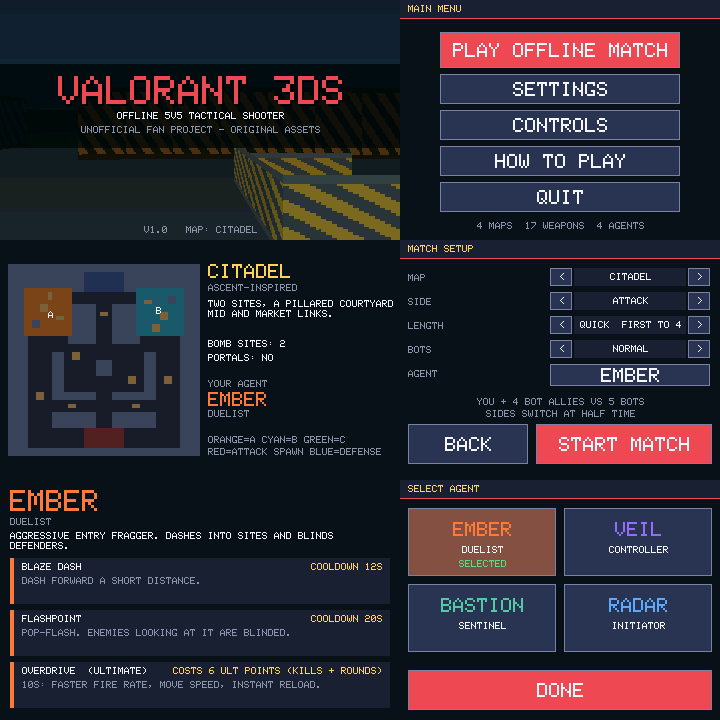
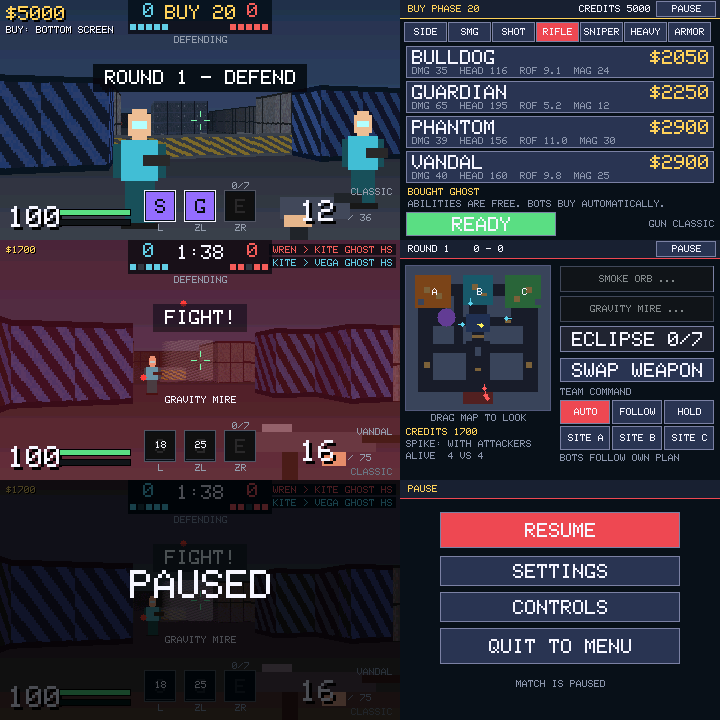

# Valorant 3DS (v1.0)

An **offline, single-player, Valorant-inspired 5v5 tactical shooter** for the Nintendo 3DS family,
written in C for devkitARM + libctru. You and four bot allies face five bots in round-based
Attack/Defend matches with a buy phase, economy, spike plant/defuse, agents with abilities, and four
original maps. Everything (art, textures, sprites, maps, agents, weapon models) is original and
procedurally generated in code. *Unofficial fan project; not affiliated with or endorsed by Riot Games.*




> Screenshots are renders of the real game code on a desktop test harness (the framebuffer is dumped
> to PNG). They are **not** captures from a 3DS.

---

## 1. Build it with GitHub Actions (recommended)

1. Create an empty GitHub repository.
2. Put the **contents** of this project at the repository root (so `Makefile`, `source/`, `tools/` and
   `.github/workflows/build.yml` sit at the top level — not inside a sub-folder).
   * `.github` is a hidden folder. If your upload method skips hidden folders, create
     `.github/workflows/build.yml` yourself and paste in `ci/build.yml`.
3. Push to `main` (or `master`). Open the repo's **Actions** tab → *Build Valorant 3DS*.
4. When it finishes, open the run and download the artifacts:
   * **`valorant3ds-3dsx`** → `valorant3ds.3dsx` + `.smdh` (+ `.elf`). **This is the main build.**
   * **`valorant3ds-3ds-and-cia`** → `valorant3ds.3ds` and `valorant3ds.cia` (optional, best-effort job).
5. Tag a release (`git tag v1.0.0 && git push --tags`) to have the `.3dsx` attached to a GitHub Release.

The workflow has four jobs:

| Job | What it does | Required? |
|---|---|---|
| `test` | Builds and runs all host-side tests with ASan/UBSan (plain gcc) | yes |
| `build` | `devkitpro/devkitarm` container → installs `3ds-dev` → `make` → `.3dsx` | yes |
| `package` | Fetches/builds `makerom` + `bannertool`, then `make 3ds` and `make cia` | no (`continue-on-error`) |
| `release` | On `v*` tags, attaches the `.3dsx` to a Release | tags only |

You can also trigger it manually (**Run workflow**, `workflow_dispatch`).

### Honest status of the CI path
The environment this project was authored in has **no network and no devkitPro**, so the genuine
`arm-none-eabi-gcc` + libctru build, the `.3dsx` link, and the `.3ds`/`.cia` packaging were **never run
by me**. What I did instead is described in section 6. The Makefile follows the standard devkitPro
3DS template and the platform layer is small (one file, ~100 lines) to minimise risk, but **your first
Actions run is the first real compile**. If it fails, open the failing step's log: the most likely
culprits are a libctru API signature in `source/platform_3ds.c`, or the optional packaging tools.
Everything else in `source/` is plain C99 that compiles cleanly with `-Wall -Wextra` on a host.

---

## 2. Build locally

Requirements: devkitPro with devkitARM, libctru (`dkp-pacman -S 3ds-dev`).

```sh
export DEVKITPRO=/opt/devkitpro DEVKITARM=/opt/devkitpro/devkitARM
./build.sh            # -> valorant3ds.3dsx
./build.sh 3ds        # -> valorant3ds.3ds  (needs makerom + bannertool; tools/get_tools.sh installs them on Linux)
./build.sh cia        # -> valorant3ds.cia
./build.sh test       # host tests only (needs just gcc)
```

(`make`, `make 3ds`, `make cia`, `make test` do the same.) The Makefile probes your libctru for the
C-Stick API (`hidCstickRead` vs. the older `irrst*` functions) and compiles the matching code path; if
neither exists the game still works with D-Pad and touch look.

### Running
* **Real console:** copy `valorant3ds.3dsx` to `sdmc:/3ds/` and launch via the Homebrew Launcher.
  Settings are saved to `sdmc:/3ds/valorant3ds/settings.bin`.
* **Emulator:** open the `.3dsx` (or `.3ds`/`.cia`) in Citra/Azahar.
* The `.3ds` made by `makerom` is not a signed retail image. It is meant for emulators and
  custom-firmware setups; the `.3dsx` is the format to use on hardware.

---

## 3. How to play

You and 4 bots (the "squad") play against 5 bots. Attackers carry the **spike** to a bomb site, plant it
(hold *Use* 4 s) and defend it until it detonates (45 s). Defenders stop the plant or defuse it
(hold *Use* 7 s, with a checkpoint at half). Rounds also end on elimination; if the time runs out
(100 s) defenders win. First to the target (4 / 7 / 13 rounds) wins; sides switch at half-time and
economy/loadouts reset.

### Default controls ("STANDARD" layout)
| Input | Action |
|---|---|
| Circle Pad | Move |
| C-Stick / D-Pad / drag on the minimap | Look |
| R | Fire (hold for automatics) |
| A | Jump (clear low cover, stand on crates) |
| B | Reload |
| Y | Use (hold to plant / defuse) |
| X | Swap weapon |
| L / ZL / ZR | Ability 1 / Ability 2 / Ultimate (New 3DS for ZL/ZR) |
| SELECT | Walk (slow and quiet) / scope with Marshal, Outlaw, Operator |
| START | Pause |

Bottom-screen touch buttons exist for both abilities, the ultimate, weapon swap and team commands, so
the **Old 3DS** is fully playable. **CONTROLS** offers three presets (Standard, Old 3DS, Southpaw) and
lets you rebind every action to any button; **SETTINGS** has look speeds, invert Y, D-Pad look, touch
look, aim assist, field of view, quality (High 400 columns / Fast 200 columns) and an FPS counter.

### Buy phase and economy
20 s buy phase, restricted to your spawn. Tap a category tab on the bottom screen, then a weapon.
Light shield 400 (25), heavy shield 1000 (50), absorbing 2/3 of damage. Start 800 credits; round win
+3000; loss +1900/+2400/+2900 by loss streak; kill +200; +300 to losing attackers who planted; cap 9000.
Survivors keep gear; replacing a gun in the same phase refunds it. Bots buy automatically.

---

## 4. Implemented features

**Match flow:** 5v5 offline matches, Attacker/Defender sides, buy phase, combat phase, spike carry/drop/
pick-up, plant, defuse with checkpoint, detonation damage, all round-end conditions, economy, half-time
side swap, match victory/defeat screen with scoreboard, rematch.

**Weapons (17, with price, damage by body/head/leg, fire rate, magazine/reserve, reload time, spread,
movement penalty, recoil, damage falloff, semi/full-auto, scopes):** Classic, Ghost, Sheriff, Frenzy,
Stinger, Spectre, Bucky, Judge, Bulldog, Guardian, Phantom, Vandal, Marshal, Outlaw, Operator, Ares, Odin.
Values are Valorant-*inspired*, hitscan, with head/body/leg zones.

**Agents (4 original, 3 abilities each, cooldowns + HUD):**
* **Ember** (Duelist): Blaze Dash, Flashpoint (pop flash), Overdrive (ult).
* **Veil** (Controller): Smoke Orb (blocks vision), Gravity Mire (slow field), Eclipse (huge smoke, ult).
* **Bastion** (Sentinel): Tripwire (hidden trap), Sentry (auto turret), Reinforce (team heal, ult).
* **Radar** (Initiator): Scan Pulse, Stun Bolt, Sweep (reveal all, ult).

**Maps (4 original layouts):** *Citadel* (Ascent-inspired, 2 sites, courtyard mid), *Trinity*
(Haven-inspired, 3 sites), *Portals* (Bind-inspired, no mid, two linked teleporters), *Ramparts*
(Split-inspired, choked mid, ramps). Each has bomb sites, lanes, low cover you can jump/shoot over,
spawn rooms.

**Bots:** navigation fields (BFS with teleporter links), team plans (stage, execute, lurker, retake,
post-plant guard), line-of-sight vision with FOV, hearing of footsteps and gunfire, reaction time, aim
error and turn-rate by difficulty (Easy/Normal/Hard), burst fire, strafing, cover seeking at low
health, reloading, spike pick-up/plant/defuse, ability use, buying. Your allies obey team commands
(Auto / Follow / Hold / Site A-B-C).

**3DS integration:** top screen 400x240 3D view + HUD; bottom screen touch UI (menus, buy menu, minimap,
abilities, commands); Circle Pad, C-Stick, D-Pad, touch-look, rebindable buttons, saved settings,
RGB565 framebuffers, fixed 30 Hz simulation with real-time catch-up.

---

## 5. Limitations (please read)

* **Not compiled/run on a 3DS by the author** (see section 1 and 6). Performance is therefore
  *unmeasured on hardware*. On a desktop, one render frame takes ~0.09 ms and a sim tick ~0.002 ms;
  a 268 MHz ARM11 is very roughly 50-100x slower on this kind of code, which suggests the 30 FPS target
  is realistic, but that is an estimate. "Quality: Fast" halves the rendered columns.
* Software renderer (column ray caster), **not citro3d/GPU**: single-height walls, flat floor/ceiling,
  billboard characters, no real multi-level geometry. Chosen because it is simple to verify and fits the
  3DS framebuffer layout; a GPU renderer would be a rewrite of `render3d.c`.
* No audio, no stereoscopic 3D, no bullet penetration, no knife, no mid-match scoreboard.
* Abilities are original and free (cooldown/ultimate-point based, not bought with credits).
* Overtime is simplified: first to N wins, no win-by-two.
* Weapon stats and maps are inspired by, not copies of, the originals.
* Bots do not jump; they path around low cover.
* The `.3ds`/`.cia` packaging (`assets/app.rsf`, `tools/package.sh`) is unverified.

---

## 6. What was actually tested (host harness, `./build.sh test`)

All run with gcc, AddressSanitizer + UBSan, and **pass**:

* **Maps:** every map: every open cell reachable; all sites reachable from both spawns.
* **Simulation:** 24 complete bot-vs-bot matches (4 maps x 3 difficulties x 2) with per-tick invariants
  (no NaNs, no unit inside geometry, HP/armor/credit/ammo bounds). Spike plants, defuses and
  detonations occur naturally.
* **Rules (228 checks):** per-weapon damage by zone, fire rate, semi-auto behaviour, reload time and
  ammo for all 17 weapons; falloff; armor; no shooting through walls; buy rules and refunds; plant /
  interrupt / checkpoint defuse / detonation; economy and loss bonuses; credit cap; half-time swap;
  match end; every ability type; smoke blocking vision; cooldowns; jumping onto cover; portals.
* **UI/controls end-to-end:** taps through every screen, picks map/side/agent/difficulty, buys, starts
  rounds, moves/shoots/looks with Circle Pad, C-Stick, D-Pad and touch, uses abilities by button and
  touch, pauses (simulation freezes), rebinds, applies presets, saves/reloads settings, finishes a
  match, rematches.
* **Main loop:** the real `main.c` runs 3000 polls against the host platform.
* **Rendering:** screenshots inspected by eye (textures, cover, sprites, smoke, HUD, menus).
* `platform_3ds.c` is only **type-checked against a mock `3ds.h`** that I wrote from the libctru docs,
  which proves internal consistency, not that the real API matches.

---

## 7. Project layout

```
source/   game.c (rules/sim) ai.c (bots) map.c (grid, trace, nav) data.c (weapons/agents/maps)
          render3d.c (ray caster + sprites) hud.c gfx.c (2D + font) app.c (screens/touch UI/input)
          settings.c main.c platform.h platform_3ds.c (libctru, the only file that includes <3ds.h>)
tests/    map_test sim_test rules_test ui_test bench (+ host/platform_host.c, mock3ds/3ds.h)
tools/    run_tests.sh package.sh get_tools.sh probe_cstick.sh gen_assets.py
assets/   icon.png banner.png banner.wav app.rsf
ci/       copy of the workflow (for upload methods that skip hidden folders)
```

### Changes from the uploaded prototype
The prototype was a ~10 KB single-file ray-caster demo. It was replaced rather than patched because
its framebuffer writes assumed a row-major layout (the 3DS LCD framebuffers are column-major and
rotated), its Makefile did not follow the standard devkitPro 3DS template (no `.smdh`/`.3dsx` rules),
and it had one map, one weapon and no menus. Its core idea (DDA ray casting, top/bottom screen split,
bots, spike objective) was kept and extended.
